- [ggcalendar](#ggcalendar)
- [Step 00. Convenience functions, dates vectors to data
  frames.](#step-00-convenience-functions-dates-vectors-to-data-frames)
  - [Examples](#examples)
- [Step 1 & 2. Compute: from date to x/y, & define
  StatCalendar](#step-1--2-compute-from-date-to-xy--define-statcalendar)
  - [Test it out](#test-it-out)
- [Step 3. Let’s write a user-facing function
  `stat_calendar()`](#step-3-lets-write-a-user-facing-function-stat_calendar)
  - [Test `stat_calendar`](#test-stat_calendar)
- [aliasing and convenience](#aliasing-and-convenience)
- [`defaults_calendar` & `ggcalendar()` Thinking about set of
  scales/coords etc, that gives you a nice calendar (to wrap up into
  defaults)](#defaults_calendar--ggcalendar-thinking-about-set-of-scalescoords-etc-that-gives-you-a-nice-calendar-to-wrap-up-into-defaults)
  - [`theme_calendar`, `defaults_calendar` &
    `ggcalendar()`](#theme_calendar-defaults_calendar--ggcalendar)
  - [More](#more)
- [NYC flights Example](#nyc-flights-example)
- [Births example](#births-example)
- [data defaults to calendar year and aes(date =
  date)](#data-defaults-to-calendar-year-and-aesdate--date)
- [Minimal Viable Packaging](#minimal-viable-packaging)
- [Traditional README](#traditional-readme)

<!-- README.md is generated from README.Rmd. Please edit that file -->

# ggcalendar

<!-- badges: start -->

[](https://lifecycle.r-lib.org/articles/stages.html#experimental)
<!-- badges: end -->

*Note: This README walks through package rational and contains the code
that defines proposed package functions and in addition to first-cut
testing. [TLDR - Jump to traditional readme
content](#traditional-readme)*

Here’s a proposal for creating calendars with ggplot2 via Stat
extension.

When using calendars, ‘when?’ and ‘where?’ are the same question! So,
ggcalendar introduces a new positional aesthetic: ‘date’. Let’s *put*
things on the calendar!

In this proposed package, we’ll specify the position of a calendar event
calendar using dates as the required aesthetic:
`aes(date = my_variable_of_dates)`! Then you can use layers function
`stat_calendar()` and derivative geom functions `geom_calendar_text`,
`geom_calendar_tile` and `geom_calendar_point` to place specific
grobs/mark in the plot space.

Under the hood, the compute_group functions finds the x and y position
for the date in the month (x is day in week and y is week in month).
Faceting by month is used to prevent over-plotting. Note: automatic
faceting by month via ggcalendar() function presupposes that your
variable is also named ‘date’.

Other possible directions would be to calculate x and y based on date in
month *and* on month - instead of relying on faceting by month.
Furthermore, a dedicated Coord could be created (Teun’s thought). Then
maybe dates would just feed generically in as the ‘x’ aes - this sounds
cool!

``` r
# library(ggcalendar)
library(ggplot2)
library(lubridate)
library(tidyverse)
```

``` r
# install.packages("devtools")
devtools::install_github("EvaMaeRey/ggcalendar")
```

# Step 00. Convenience functions, dates vectors to data frames.

Because ggplot2’s diet is consists solely of dataframes, we create a
number of convenience functions that will help us produce dataframes
with column ‘date’ we can feed into ggplot2.

``` r
knitrExtra:::chunk_to_r("df_functions")
```

``` r
#' Title
#'
#' @return
#' @export
#'
#' @examples
df_today <- function(){

  data.frame(date = Sys.Date())

}

#' Title
#'
#' @param date 
#'
#' @return
#' @export
#'
#' @examples
df_day <- function(date = NULL){
  
  if(is.null(date)){date <- Sys.Date()}

  data.frame(date = date)

}


#' Title
#'
#' @param start_date 
#' @param end_date 
#'
#' @return
#' @export
#'
#' @examples
df_dates_interval <- function(start_date, end_date){

  data.frame(date = as.Date(start_date):as.Date(end_date) |>
    as.Date())

}

#' Title
#'
#' @param month 
#' @param year 
#'
#' @return
#' @export
#'
#' @examples
df_month <- function(month = NULL, year = NULL){

  if(is.null(month)){
    
    date <- Sys.Date()
    month <- lubridate::month(date) 
  }
   
  if(is.numeric(month)){ 
    
    month <- stringr::str_pad(month, width = 2, pad = "0")
    
  }
  
    if(is.null(year)){
    
    date <- Sys.Date()
    year <- lubridate::year(date)
    }

  
  paste0(year,"-", month, "-01") |>
    lubridate::as_date() ->
    start_date

  start_date |> lubridate::ceiling_date(unit = "month") ->
    end_date

    data.frame(date = 
                 df_dates_interval(start_date, 
                                       end_date - lubridate::days(1)))

}

#' Title
#'
#' @param date 
#'
#' @return
#' @export
#'
#' @examples
df_week <- function(date = NULL){

  if(is.null(date)){date <- Sys.Date()}

  start_date <- lubridate::floor_date(date, unit = "week")
  end_date <- lubridate::ceiling_date(date, unit = "week")

  data.frame(date = df_dates_interval(start_date, 
                        end_date - lubridate::days(1)) )

}

#' Title
#'
#' @param date 
#'
#' @return
#' @export
#'
#' @examples
return_df_hours_week <- function(date = NULL){

  if(is.null(date)){date <- Sys.Date()}

  start_date <- lubridate::floor_date(date, unit = "week")

  data.frame(date = (start_date + lubridate::hours(1:(24*7-1))))

}

#' Title
#'
#' @param year 
#'
#' @return
#' @export
#'
#' @examples
df_year <- function(year = NULL){

  if(is.null(year)){year <-  lubridate::year(Sys.Date())}

  paste0(year, "-01-01") |>
    lubridate::as_date() ->
  start_date

  start_date |> lubridate::ceiling_date(unit = "year") ->
    end_date

    data.frame(date = 
                 df_dates_interval(start_date, 
                                       end_date - lubridate::days(1)))
    
}
```

## Examples

Let’s have a look at some of these.

``` r
df_today()
#>         date
#> 1 2025-03-28

df_day()
#>         date
#> 1 2025-03-28

df_dates_interval(start_date = "2024-10-02", end_date = "2024-10-04")
#>         date
#> 1 2024-10-02
#> 2 2024-10-03
#> 3 2024-10-04

df_week()
#>         date
#> 1 2025-03-23
#> 2 2025-03-24
#> 3 2025-03-25
#> 4 2025-03-26
#> 5 2025-03-27
#> 6 2025-03-28
#> 7 2025-03-29

df_year() |> head()
#>         date
#> 1 2025-01-01
#> 2 2025-01-02
#> 3 2025-01-03
#> 4 2025-01-04
#> 5 2025-01-05
#> 6 2025-01-06

df_month() |> head()
#>         date
#> 1 2025-03-01
#> 2 2025-03-02
#> 3 2025-03-03
#> 4 2025-03-04
#> 5 2025-03-05
#> 6 2025-03-06

return_df_hours_week() |> head()
#>                  date
#> 1 2025-03-23 01:00:00
#> 2 2025-03-23 02:00:00
#> 3 2025-03-23 03:00:00
#> 4 2025-03-23 04:00:00
#> 5 2025-03-23 05:00:00
#> 6 2025-03-23 06:00:00
```

# Step 1 & 2. Compute: from date to x/y, & define StatCalendar

The computation that we want to be done under the hood relates to
translating the here-to-fore unknown positional aesthetic ‘date’ to the
first-class ‘x’ and ‘y’ positional aesthetic mappings, as well as
variables that can be used in faceting (month).

``` r
knitrExtra:::chunk_to_r("get_week_of_month")
```

As a pre-step to computing many useful variables from our date variable,
we focus on this (currently messy) conversion of vectors of dates to
week of the month.

``` r
get_week_of_month <- function(x){
  
  (- lubridate::wday(x) + lubridate::day(x)) %/% 
    7 + 1 +
    ifelse(lubridate::wday(lubridate::floor_date(lubridate::as_date(x), "month")) == 1, 0, 1)
  
}
```

Next, we’ll define a compute group function. A number of variables are
created by parsing our date variable.

Then, we’ll pass all this computation to define a new ggproto object
StatCalendar. For maximum flexibility, our compute function doesn’t
create ggplot2 core aesthetic channels ‘x’, ‘y’, and ‘label’ variables,
but instead uses the default_aes field to state what should be first
interpreted as x, y and label (thoughts? Maybe only ‘label’ should be
managed like this).

``` r
knitrExtra:::chunk_to_r("compute_group_calendar")
```

``` r
date_df_parse <- function(data){
  
  data |>
    dplyr::mutate(wday = lubridate::wday(.data$date)) |>
    dplyr::mutate(wday_abbr = lubridate::wday(.data$date, label = TRUE, abbr = TRUE)) |>
    dplyr::mutate(week_of_month = get_week_of_month(.data$date)) |>
    dplyr::mutate(day = lubridate::day(.data$date)) |>
    dplyr::mutate(year = lubridate::year(.data$date) - 2018) |>
    dplyr::mutate(month_abbr = lubridate::month(.data$date, abbr = TRUE, label = TRUE)) |>
    dplyr::mutate(hour = lubridate::hour(.data$date)) |>
    dplyr::mutate(year_academic =  lubridate::year(.data$date) +
                    ifelse(lubridate::month(date) >
                             6, 1, 0)) |>
    dplyr::mutate(month_academic_abbr = .data$month_abbr |>
                    factor(levels = c("Jul", "Aug", "Sep", "Oct", "Nov", "Dec",
                                      "Jan", "Feb", "Mar", "Apr", "May", "Jun")))
}


compute_panel_calendar <- function(data, scales, complete = F, start_date = NULL, end_date = NULL ){
  
  if(!complete){
    
      data |> date_df_parse()

  }else{ # complete case; fill in all days of month
  
    data$date <- as.Date(data$date)
    
    month_start <- lubridate::floor_date(min(data$date), unit = "month")
    month_end <- (lubridate::ceiling_date(max(data$date), unit = "month") - days(1))
                              
    df_dates_interval(month_start, month_end) |>
      date_df_parse() ->
    completed
    
    if(!is.null(start_date)){completed <- completed |> dplyr::filter(completed$date >= as.Date(start_date)) }
    if(!is.null(end_date)){completed <- completed |> dplyr::filter(completed$date <= as.Date(end_date)) }
    
    completed

   }
}
  
StatCalendar <- ggplot2::ggproto(`_class` = "StatCalendar",
                                 `_inherit` = ggplot2::Stat,
                                 required_aes = c("date"),
                                 compute_panel = compute_panel_calendar,
                                 default_aes = ggplot2::aes(x = ggplot2::after_stat(wday),
                                                            y = ggplot2::after_stat(week_of_month),
                                                            label = ggplot2::after_stat(day)))


StatWeekly <- ggplot2::ggproto(`_class` = "StatCalendar",
                               `_inherit` = ggplot2::Stat,
                               required_aes = c("date"),
                               compute_panel = compute_panel_calendar,
                               default_aes = ggplot2::aes(x = ggplot2::after_stat(wday),
                                                          y = ggplot2::after_stat(hour),
                                                          label = ggplot2::after_stat(hour)))
```

## Test it out

Okay, let’s see how our compute and Stat work in action!

``` r
df_week() |>
  compute_panel_calendar()
#>         date wday wday_abbr week_of_month day year month_abbr hour
#> 1 2025-03-23    1       Sun             5  23    7        Mar    0
#> 2 2025-03-24    2       Mon             5  24    7        Mar    0
#> 3 2025-03-25    3       Tue             5  25    7        Mar    0
#> 4 2025-03-26    4       Wed             5  26    7        Mar    0
#> 5 2025-03-27    5       Thu             5  27    7        Mar    0
#> 6 2025-03-28    6       Fri             5  28    7        Mar    0
#> 7 2025-03-29    7       Sat             5  29    7        Mar    0
#>   year_academic month_academic_abbr
#> 1          2025                 Mar
#> 2          2025                 Mar
#> 3          2025                 Mar
#> 4          2025                 Mar
#> 5          2025                 Mar
#> 6          2025                 Mar
#> 7          2025                 Mar

df_week() |>
  compute_panel_calendar(complete = T)
#>          date wday wday_abbr week_of_month day year month_abbr hour
#> 1  2025-03-01    7       Sat             1   1    7        Mar    0
#> 2  2025-03-02    1       Sun             2   2    7        Mar    0
#> 3  2025-03-03    2       Mon             2   3    7        Mar    0
#> 4  2025-03-04    3       Tue             2   4    7        Mar    0
#> 5  2025-03-05    4       Wed             2   5    7        Mar    0
#> 6  2025-03-06    5       Thu             2   6    7        Mar    0
#> 7  2025-03-07    6       Fri             2   7    7        Mar    0
#> 8  2025-03-08    7       Sat             2   8    7        Mar    0
#> 9  2025-03-09    1       Sun             3   9    7        Mar    0
#> 10 2025-03-10    2       Mon             3  10    7        Mar    0
#> 11 2025-03-11    3       Tue             3  11    7        Mar    0
#> 12 2025-03-12    4       Wed             3  12    7        Mar    0
#> 13 2025-03-13    5       Thu             3  13    7        Mar    0
#> 14 2025-03-14    6       Fri             3  14    7        Mar    0
#> 15 2025-03-15    7       Sat             3  15    7        Mar    0
#> 16 2025-03-16    1       Sun             4  16    7        Mar    0
#> 17 2025-03-17    2       Mon             4  17    7        Mar    0
#> 18 2025-03-18    3       Tue             4  18    7        Mar    0
#> 19 2025-03-19    4       Wed             4  19    7        Mar    0
#> 20 2025-03-20    5       Thu             4  20    7        Mar    0
#> 21 2025-03-21    6       Fri             4  21    7        Mar    0
#> 22 2025-03-22    7       Sat             4  22    7        Mar    0
#> 23 2025-03-23    1       Sun             5  23    7        Mar    0
#> 24 2025-03-24    2       Mon             5  24    7        Mar    0
#> 25 2025-03-25    3       Tue             5  25    7        Mar    0
#> 26 2025-03-26    4       Wed             5  26    7        Mar    0
#> 27 2025-03-27    5       Thu             5  27    7        Mar    0
#> 28 2025-03-28    6       Fri             5  28    7        Mar    0
#> 29 2025-03-29    7       Sat             5  29    7        Mar    0
#> 30 2025-03-30    1       Sun             6  30    7        Mar    0
#> 31 2025-03-31    2       Mon             6  31    7        Mar    0
#>    year_academic month_academic_abbr
#> 1           2025                 Mar
#> 2           2025                 Mar
#> 3           2025                 Mar
#> 4           2025                 Mar
#> 5           2025                 Mar
#> 6           2025                 Mar
#> 7           2025                 Mar
#> 8           2025                 Mar
#> 9           2025                 Mar
#> 10          2025                 Mar
#> 11          2025                 Mar
#> 12          2025                 Mar
#> 13          2025                 Mar
#> 14          2025                 Mar
#> 15          2025                 Mar
#> 16          2025                 Mar
#> 17          2025                 Mar
#> 18          2025                 Mar
#> 19          2025                 Mar
#> 20          2025                 Mar
#> 21          2025                 Mar
#> 22          2025                 Mar
#> 23          2025                 Mar
#> 24          2025                 Mar
#> 25          2025                 Mar
#> 26          2025                 Mar
#> 27          2025                 Mar
#> 28          2025                 Mar
#> 29          2025                 Mar
#> 30          2025                 Mar
#> 31          2025                 Mar

df_week() |>
  compute_panel_calendar(complete = T, end_date = "2025-03-23")
#>          date wday wday_abbr week_of_month day year month_abbr hour
#> 1  2025-03-01    7       Sat             1   1    7        Mar    0
#> 2  2025-03-02    1       Sun             2   2    7        Mar    0
#> 3  2025-03-03    2       Mon             2   3    7        Mar    0
#> 4  2025-03-04    3       Tue             2   4    7        Mar    0
#> 5  2025-03-05    4       Wed             2   5    7        Mar    0
#> 6  2025-03-06    5       Thu             2   6    7        Mar    0
#> 7  2025-03-07    6       Fri             2   7    7        Mar    0
#> 8  2025-03-08    7       Sat             2   8    7        Mar    0
#> 9  2025-03-09    1       Sun             3   9    7        Mar    0
#> 10 2025-03-10    2       Mon             3  10    7        Mar    0
#> 11 2025-03-11    3       Tue             3  11    7        Mar    0
#> 12 2025-03-12    4       Wed             3  12    7        Mar    0
#> 13 2025-03-13    5       Thu             3  13    7        Mar    0
#> 14 2025-03-14    6       Fri             3  14    7        Mar    0
#> 15 2025-03-15    7       Sat             3  15    7        Mar    0
#> 16 2025-03-16    1       Sun             4  16    7        Mar    0
#> 17 2025-03-17    2       Mon             4  17    7        Mar    0
#> 18 2025-03-18    3       Tue             4  18    7        Mar    0
#> 19 2025-03-19    4       Wed             4  19    7        Mar    0
#> 20 2025-03-20    5       Thu             4  20    7        Mar    0
#> 21 2025-03-21    6       Fri             4  21    7        Mar    0
#> 22 2025-03-22    7       Sat             4  22    7        Mar    0
#> 23 2025-03-23    1       Sun             5  23    7        Mar    0
#>    year_academic month_academic_abbr
#> 1           2025                 Mar
#> 2           2025                 Mar
#> 3           2025                 Mar
#> 4           2025                 Mar
#> 5           2025                 Mar
#> 6           2025                 Mar
#> 7           2025                 Mar
#> 8           2025                 Mar
#> 9           2025                 Mar
#> 10          2025                 Mar
#> 11          2025                 Mar
#> 12          2025                 Mar
#> 13          2025                 Mar
#> 14          2025                 Mar
#> 15          2025                 Mar
#> 16          2025                 Mar
#> 17          2025                 Mar
#> 18          2025                 Mar
#> 19          2025                 Mar
#> 20          2025                 Mar
#> 21          2025                 Mar
#> 22          2025                 Mar
#> 23          2025                 Mar

df_week() |>
  ggplot() + 
  aes(date = date) + 
  geom_text(stat = StatCalendar)
```

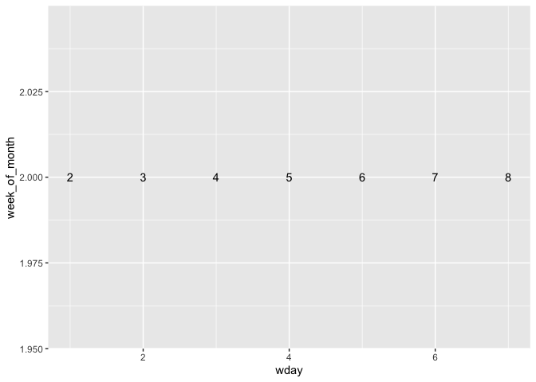

``` r

df_week() |>
  ggplot() + 
  aes(date = date) + 
  geom_text(stat = StatCalendar, complete = T)
```

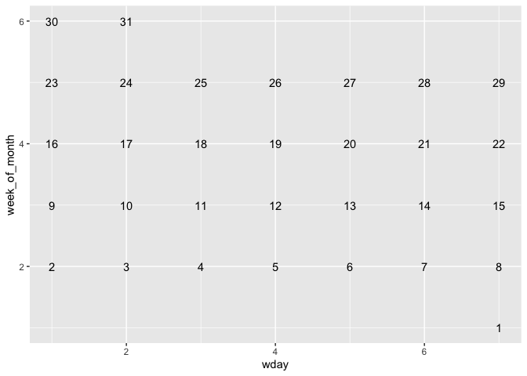

``` r

df_week() |>
  ggplot() + 
  aes(date = date) + 
  geom_text(stat = StatCalendar, complete = T, end_date = "2025-03-23")
```

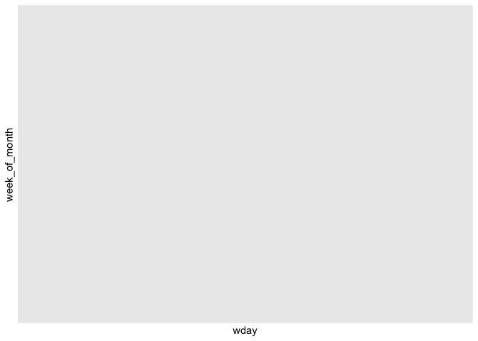

# Step 3. Let’s write a user-facing function `stat_calendar()`

``` r
knitrExtra:::chunk_to_r("a_stat_calendar")
```

``` r
#' Title
#'
#' @param mapping 
#' @param data 
#' @param geom 
#' @param position 
#' @param na.rm 
#' @param show.legend 
#' @param inherit.aes 
#' @param ... 
#'
#' @return
#' @export
#'
#' @examples
stat_calendar <- function(mapping = NULL, 
                          data = NULL,
                          geom = "text",
                          position = "identity", 
                          na.rm = FALSE,
                          show.legend = NA,
                          inherit.aes = TRUE, ...) {
  ggplot2::layer(
    stat = StatCalendar, # proto object from Step 2
    geom = geom, # inherit other behavior
    data = data,
    mapping = mapping,
    position = position,
    show.legend = show.legend,
    inherit.aes = inherit.aes,
    params = list(na.rm = na.rm, ...)
  )
}
```

### Test `stat_calendar`

``` r
df_year() |> 
  ggplot() + 
  aes(date = date) +
  stat_calendar(color = "grey") + 
  facet_wrap(~month(date, label = T,  abbr = T)) + 
  scale_y_reverse()
```

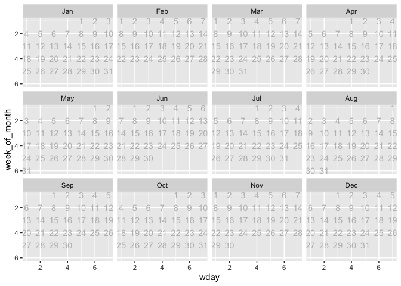

# aliasing and convenience

To give the user a better sense of what they’ll see when using
stat_calendar we create the alias, ‘geom_calendar_text()’.

``` r
knitrExtra:::chunk_to_r("geom_calendar_text")
```

``` r
#' Title
#'
#' @param ... 
#'
#' @return
#' @export
#'
#' @examples
geom_calendar_text <- function(...){stat_calendar(geom = "text", ...)}

#' Title
#'
#' @param ... 
#'
#' @return
#' @export
#'
#' @examples
geom_calendar_point <- function(...){stat_calendar(geom = "point", ...)}

#' Title
#'
#' @param ... 
#'
#' @return
#' @export
#'
#' @examples
geom_calendar_tile <- function(...){stat_calendar(geom = "tile", ...)}


geom_calendar_strikeoff <- function(label = "X", end_date = Sys.Date() - days(1), ...){
  
  stat_calendar(geom = ggexpress:::qproto_update(GeomText, aes(color = "darkred", alpha = .85)),
                label = label, complete = T, end_date = end_date, 
                ...)
  }
```

# `defaults_calendar` & `ggcalendar()` Thinking about set of scales/coords etc, that gives you a nice calendar (to wrap up into defaults)

In our test of stat_calendar, we see cumbersomeness. Below, we consider
even more ggplot2 decision that would make our plot easier to consume
and more beautiful.

``` r
day_labels = c("S", "M", "T", "W", "T", "F", "S")

df_year() |> 
  ggplot() + 
  aes(date = date) +
  stat_calendar(color = "grey") +
    ggplot2::aes(date = date) +
    ggplot2::scale_y_reverse(breaks = 5:0, 
                             expand = c(0,0), 
                             limits = c(6.5, 0.5)) +
    ggplot2::scale_x_continuous(breaks = 1:7, 
                                labels = day_labels,
                                limits = c(.5, 7.5), 
                                expand = c(0,0)
                                ) +
    ggplot2::facet_wrap(~lubridate::month(date, abbr = T, label = T), scales = "free") +
    ggplot2::labs(x = NULL, y = NULL) +
    ggplot2::theme(axis.text.y = ggplot2::element_blank(),
          axis.ticks.y = ggplot2::element_blank(),
          axis.ticks.x = ggplot2::element_blank()) +
    ggplot2::theme(panel.grid.major = ggplot2::element_blank()) + 
    ggplot2::geom_blank() + 
  geom_calendar_strikeoff()
```

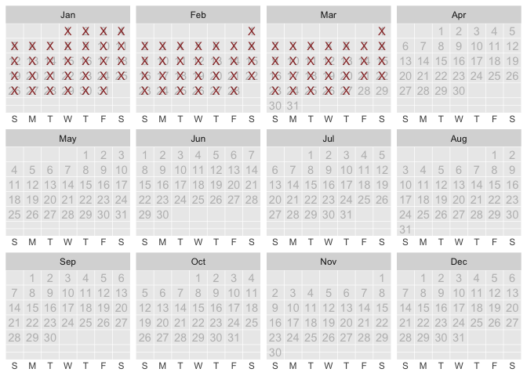

## `theme_calendar`, `defaults_calendar` & `ggcalendar()`

Then, we bundle these up into defaults_calendar, which can be quickly
added for converting to a more polished and readable calendar.

``` r
knitrExtra::chunk_to_dir("theme_calendar")
```

``` r
#' Title
#'
#' @param ... 
#'
#' @return
#' @export
#'
#' @examples
theme_calendar <- function(base_theme = theme_grey, ...){

  base_theme(...) %+replace%
    ggplot2::theme(
      axis.text.y = ggplot2::element_blank(),
      axis.ticks.y = ggplot2::element_blank(),
      axis.ticks.x = ggplot2::element_blank(),
      axis.title = element_blank()) +
    ggplot2::theme(
      panel.grid.major = ggplot2::element_blank()) 
  
}


scale_y_calendar <- function(...){ggplot2::scale_y_reverse(breaks = 6:0, 
                             expand = c(0,0), 
                             limits = c(6.5, 0.5), ...)}

scale_x_calendar <- function(day_labels = c("M", "T", "W", "T", "F", "S", "S"), ...){
  
    ggplot2::scale_x_continuous(breaks = 1:7, 
                                labels = day_labels,
                                limits = c(.5, 7.5), 
                                expand = c(0,0), ...)}

facet_calendar <- function(...){
  
  ggplot2::facet_wrap(~lubridate::month(date, abbr = T, label = T), 
                      scales = "free",...)
  
}


geom_calendar_blank <- function(...){
  
  stat_calendar(geom = "blank", ...)
  
}
```

``` r
knitrExtra:::chunk_to_r("defaults_calendar")
```

``` r
#' Title
#'
#' @param day_labels 
#'
#' @return
#' @export
#'
#' @examples
defaults_calendar <- function(day_labels = c("M", "T", "W", "T", "F", "S", "S")){
  
  week_start <- getOption("lubridate.week.start", 7)
  
  if(week_start != 1){day_labels <- day_labels[c(week_start:7, 1:(week_start-1))]}

  list(scale_y_calendar(),
       scale_x_calendar(day_labels = day_labels),
       facet_calendar(),
       theme_calendar(),
       stat_calendar(geom = "blank")
       )
  
}
```

Let’s check it out…

``` r
df_week() |> 
  ggplot() +
  aes(date = date) + 
  stat_calendar() + 
  defaults_calendar()
```

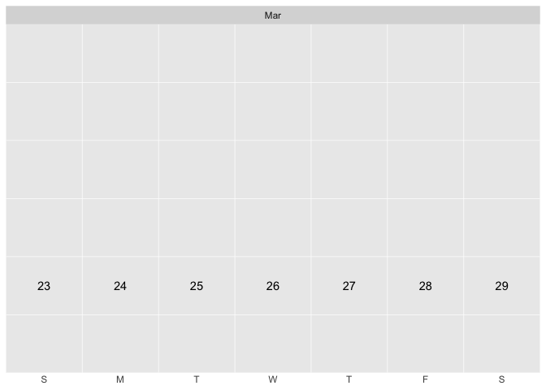

``` r

df_year() |> 
  ggplot() +
  aes(date = date) + 
  stat_calendar() + 
  defaults_calendar()
```

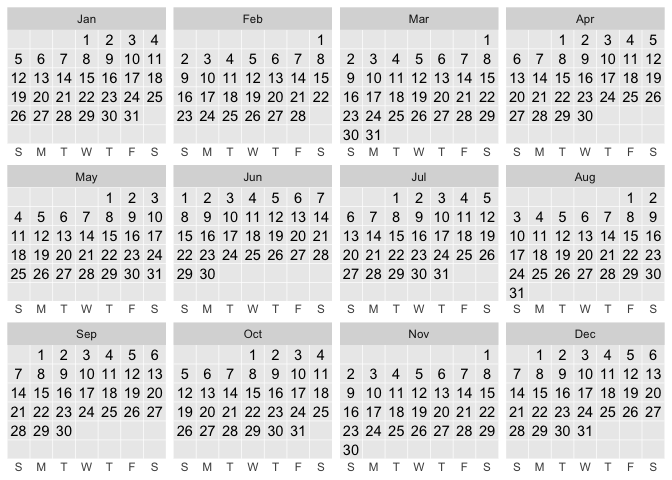

``` r


last_plot() + 
  theme_calendar(base_theme = theme_classic)
```

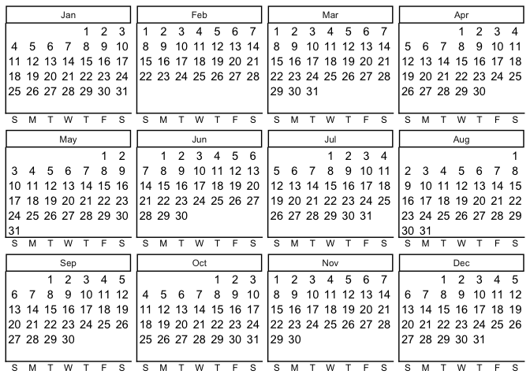

``` r

last_plot() + 
  theme_calendar(base_theme = theme_linedraw)
```

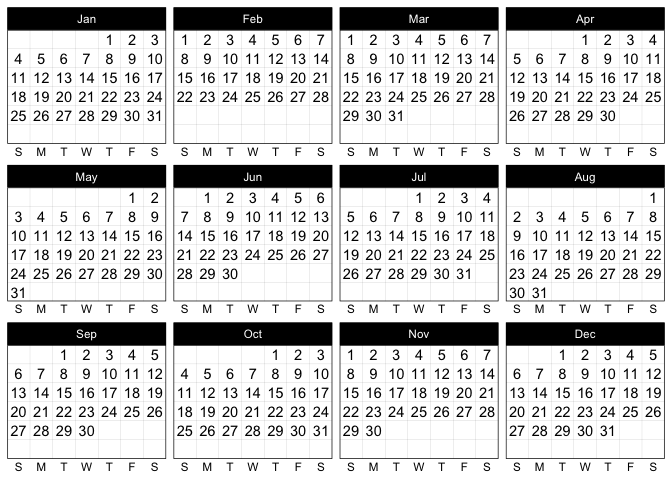

``` r

last_plot() + 
  theme_calendar(base_theme = theme_light)
```

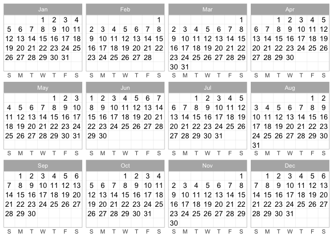

``` r

last_plot() + 
  theme_calendar(base_theme = theme_bw)
```

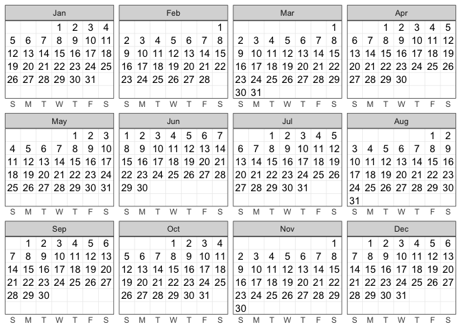

``` r

last_plot() + 
  theme_calendar(base_theme = theme_dark)
```

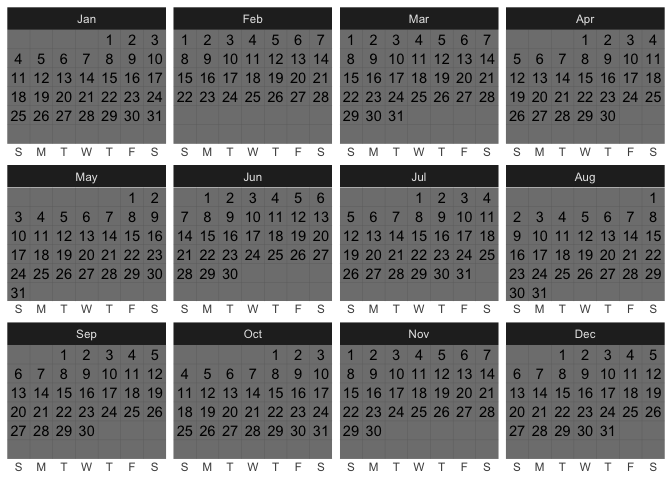

``` r

last_plot() + 
  theme_calendar(base_theme = theme_minimal)
```

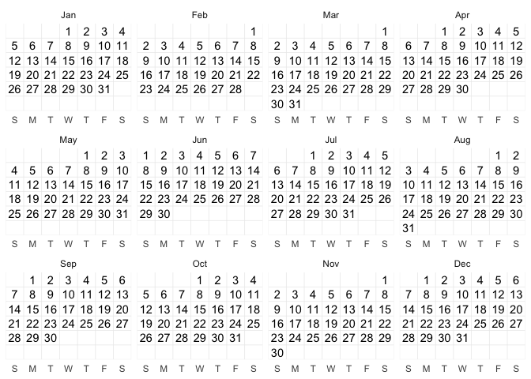

``` r

last_plot() + 
  theme_calendar(base_theme = theme_void)
```

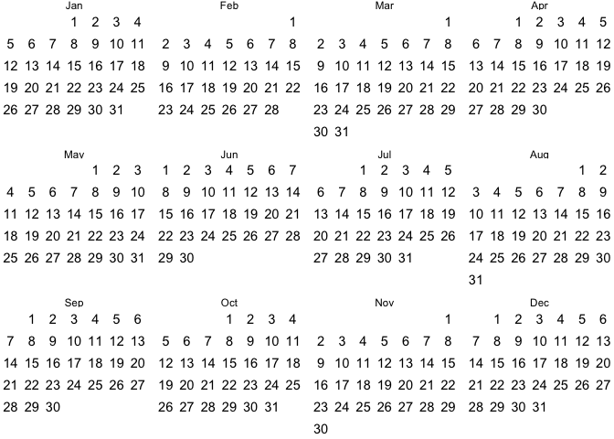

Furthermore, we provide ggcalendar as an alternative point of entry into
the ggplot framework. The default data frame is even included (the
current calendar year), so a full calendar will print with no additional
specification.

``` r
knitrExtra:::chunk_to_r("ggcalendar")
```

``` r
#' Title
#'
#' @param dates_df 
#' @param day_labels 
#' @param geom 
#' @param color 
#' @param size 
#' @param alpha 
#'
#' @return
#' @export
#'
#' @examples
ggcalendar <- function(dates_df = df_year(), 
                       day_labels = c("M", "T", "W", "T", "F", "S", "S"), 
                       geom = "blank", 
                       color = "grey35",
                       size = 3,
                       alpha = 1){
  
    my_layer <- stat_calendar(geom = geom, 
                              color = color, 
                              ggplot2::aes(date = date), 
                              size = size, 
                              alpha = alpha, 
                              show.legend = F) 

    
  ggplot2::ggplot(data = dates_df) +
  defaults_calendar(day_labels = day_labels) +
  ggplot2::aes(date = date) +
  my_layer

  }
```

Let’s check it out!

``` r
ggcalendar(geom = "text")
```

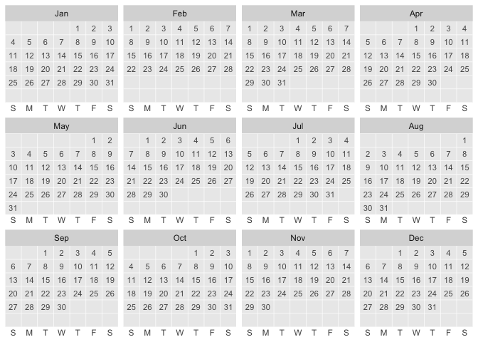

``` r

ggcalendar(geom = "text") + 
  stat_calendar(geom = "point", 
                data = df_week(),
                color = "darkred",
                size = 5,
                alpha = .5)
```

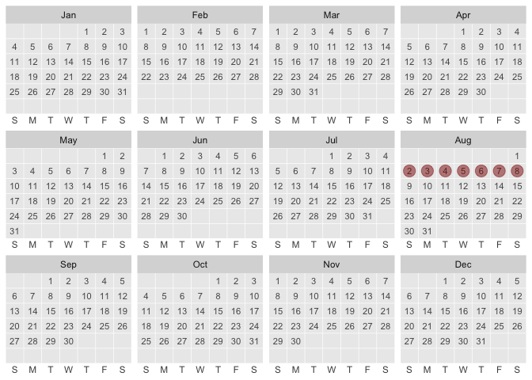

``` r

options(lubridate.week.start = 1)

ggcalendar(geom = "text") + 
  stat_calendar(geom = "point", 
                data = df_week(),
                color = "darkred",
                size = 5,
                alpha = .5)
```

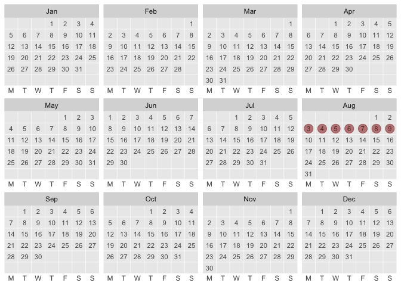

## More

``` r
library(magrittr)
ggcalendar(geom = "text") +
   # remember default data in ggcalendar() is current year of dates
  aes(date = date) +
  geom_calendar_tile(data = . %>%  
                      filter(wday(date) == 3),  
                      fill = "blue",  
                      alpha = .2) +
  labs(title = "When to do #TidyTuesday in 2025") +
  stat_calendar(label = "X",
                color = "darkred",
                size = 5,
                data = df_dates_interval(
                  "2025/01/01", Sys.Date() - days(1)),
                 alpha = .35)
```

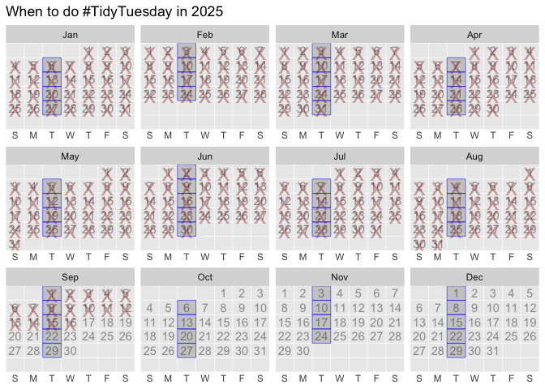

``` r
df_month(year = 2023, month = 2) |> 
  ggcalendar(geom = "text")
```

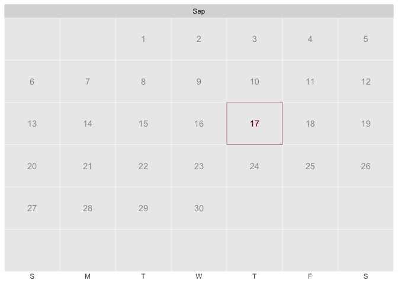

``` r

df_month(year = 2023, month = 2) |> 
ggcalendar(geom = "blank") + 
  aes(date = date) + 
  geom_calendar_text(label = "Another\nday...", # override default
                     size = 4)
```

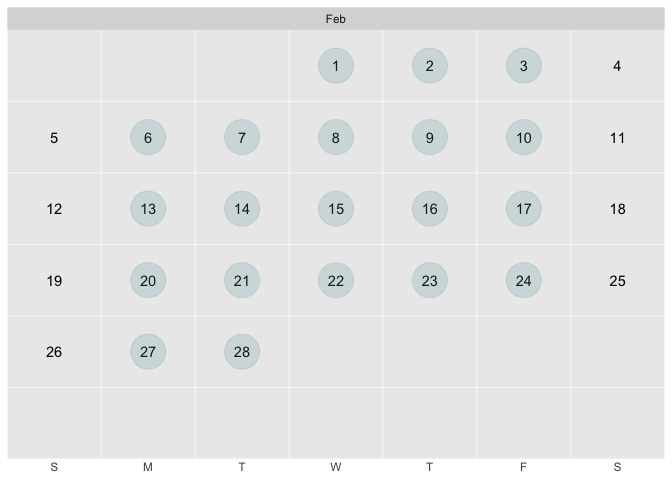

``` r

df_month(year = 2023, month = 2) |> 
ggcalendar() + 
  aes(date = date) + 
  geom_calendar_text() + 
  geom_calendar_point(data = . %>% filter(wday(date) %in% 2:6),
                      alpha = .2,
                      size = 5,
                      color = "cadetblue") + 
  theme(panel.background = element_rect(fill = "beige"))
```

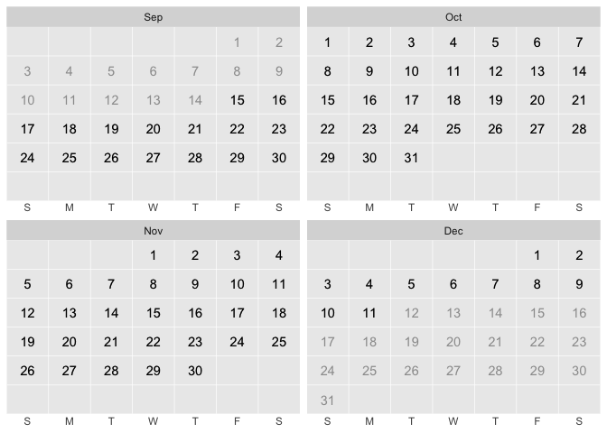

``` r

library(ggplot2)

df_dates_interval("2023-09-01", "2023-12-31") |> 
  ggcalendar()
```

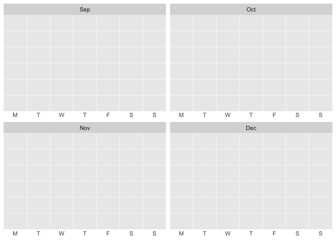

``` r
## basic example code
c("2022-03-19", 
  "2022-04-09", 
  "2022-05-07", 
  # "2022-06-11", 
  "2022-07-16") %>% 
  tibble(date = .) |> 
  mutate(date = date %>% as_date) |> 
  mutate(future = "2022-05-07" < date) ->
events

events |> 
  ggcalendar() +
  aes(date = date) +
  geom_calendar_text(complete = T) + 
  aes(color = future) +
  geom_calendar_point(size = 8, 
                      alpha = .5,
                      show.legend = F) +
  labs(title = "nu2ggplot2X^2sion, 2022")
```

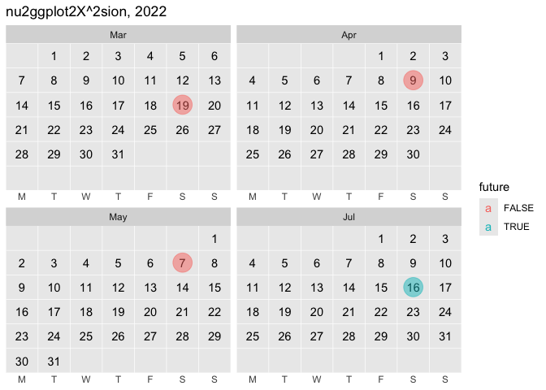

# NYC flights Example

> Airline on-time data for all flights departing NYC in 2013. Also
> includes useful ‘metadata’ on airlines, airports, weather, and planes.

Data inspiration:
<https://twitter.com/rappa753/status/1545729747774308354> @rappa753

``` r

# example 
nycflights13::flights |> 
  ungroup() |> 
  mutate(date = as.Date(time_hour)) |> 
  filter(year(date) == 2013) |> 
  count(date) |> 
  ggcalendar() +
  aes(date = date) + # optional
  geom_calendar_point(alpha = .7, 
                      shape = 21) + 
  aes(size = n, fill = n, label = n) +
  geom_calendar_text(size = 2) + 
  scale_fill_viridis_c(option = "inferno", 
                       direction = 1) + 
  theme(legend.position = "none") + 
  labs(title = "nycflights13::flights number of flights in 2013")
```

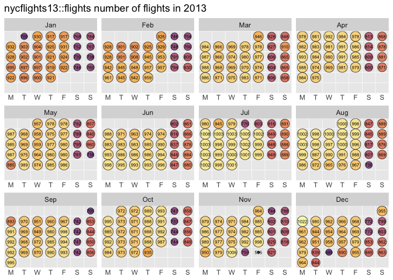

------------------------------------------------------------------------

# Births example

``` r
births <- "https://raw.githubusercontent.com/EvaMaeRey/tableau/9e91c2b5ee803bfef10d35646cf4ce6675b92b55/tidytuesday_data/2018-10-02-us_births_2000-2014.csv"

readr::read_csv(births) |> 
  mutate(month = stringr::str_pad(month, 2, pad = "0"),
         date_of_month = str_pad(date_of_month, 2, pad = "0")) |> 
  mutate(date = paste(year, month, date_of_month, sep = "-") |> as_date()) |> 
  filter(year == 2012) |> 
  ggcalendar() + 
  aes(date = date) + 
  geom_calendar_point(alpha = .4) +
  geom_calendar_text(color = "darkgrey", size = 2) +
  aes(size = births) +
  aes(color = births) +
  scale_color_viridis_c() +
  guides(colour = guide_legend("Births"), size = guide_legend("Births")) + 
  geom_calendar_point(data = data.frame(date =
                                      as_date("2012-12-25")),
                      size = 5, color = "red", shape = 21)
```

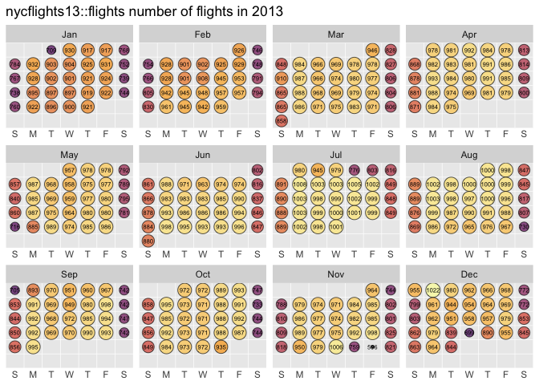

------------------------------------------------------------------------

# data defaults to calendar year and aes(date = date)

The following feels a little weird to me, but is allowed.

A grammar of graphics fundamental is that a statistical graphic are
composed of geometries/marks that take on aesthetics (color, position,
size), to represent a variable.

Below we aren’t aren’t fully stating these specifications; which feels a
bit funny; I would not recommend this as a starting point.

``` r
ggcalendar() + # there is a data default if none is provided
 geom_calendar_text()
```

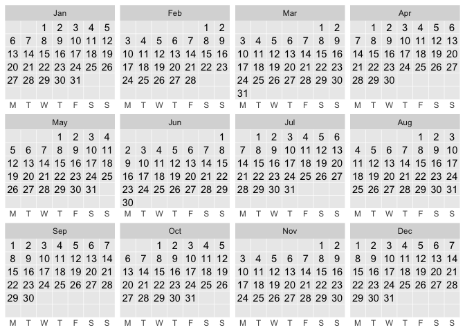

------------------------------------------------------------------------

``` r
library(tidyverse)
library(ggcalendar)

tribble(~date, ~event,
        "2025-01-21", "legendry",
        "2025-02-12", "ggtime",
        "2025-03-05", "ggproto",
        "2025-04-09", "tidyplots") |>
  mutate(date = date) |>
  ggcalendar() + 
  aes(date = date) +
  geom_calendar_tile() + 
  aes(fill = event |> fct_inorder()) +
  geom_calendar_text(complete = T) + 
  geom_calendar_strikeoff() +
  theme_calendar(base_size = 15) + 
  labs(fill = NULL) + 
  geom_calendar_tile(data = df_day(), color = "darkred",
                     fill = "transparent", linewidth = 1)
```

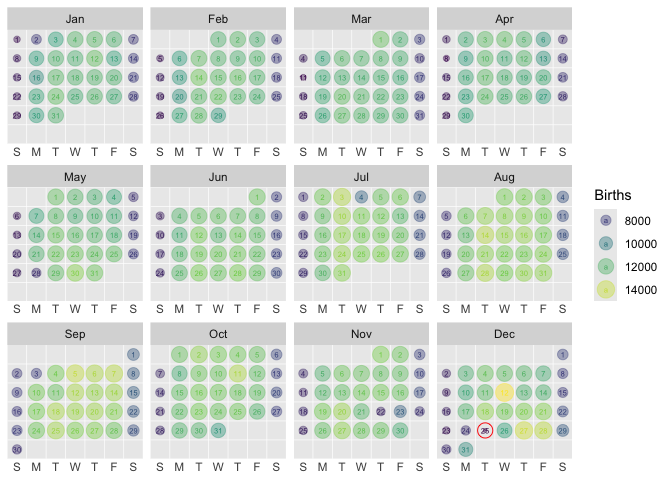

------------------------------------------------------------------------

# Minimal Viable Packaging

``` r
usethis::use_package("lubridate")
usethis::use_package("ggplot2")
usethis::use_package("dplyr")
usethis::use_package("stringr")
```

``` r
devtools::check(".")
devtools::install(pkg = ".", upgrade = "never") 
```

# Traditional README

``` r
# rm(list = ls())
library(ggcalendar)
library(tidyverse)
options(lubridate.week.start = 1) # start on Monday

ggcalendar() + 
  labs(title = "Calendar: 2025")
```

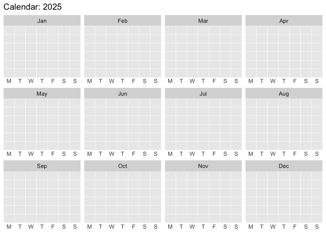

``` r

ggcalendar() + 
  geom_calendar_tile(
    data = df_week(),
    fill = "red",
    alpha = .25) + 
  geom_calendar_point(
    data = df_today(),
    color = "goldenrod3", shape = 21,
    size = 8, stroke = 1.5
    )
```

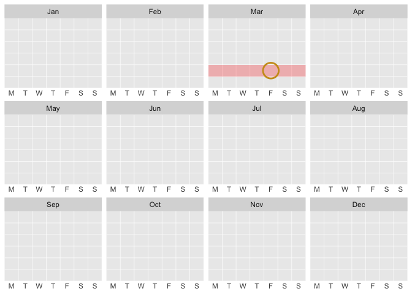

``` r


# example 
nycflights13::flights |> 
  ungroup() |> 
  mutate(date = as.Date(time_hour)) |> 
  filter(year(date) == 2013) |> 
  count(date) |> 
  ggcalendar(geom = "blank") +
      aes(date = date) +
      geom_calendar_tile(
        aes(fill = n),
        alpha = .7, show.legend = F) + 
      scale_fill_viridis_c(option = "inferno", 
                            direction = 1) + 
      scale_size(range = c(3,8)) +
      geom_calendar_text(aes(label = n), 
                         size = 2) + 
      NULL
```

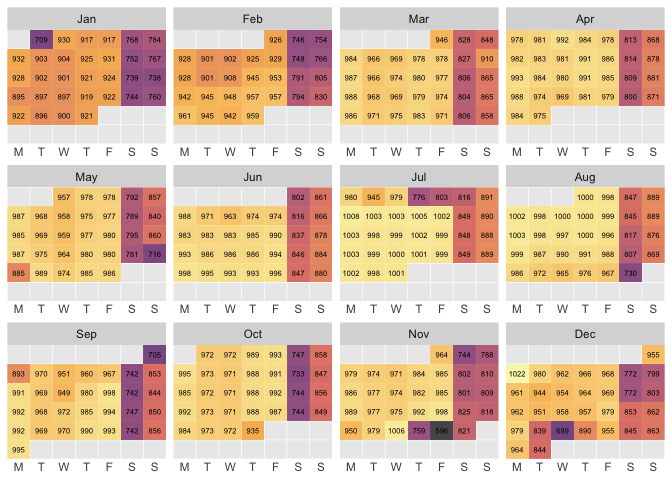

``` r
contrast <- function(colour) {
  out   <- rep("grey35", length(colour))
  light <- farver::get_channel(colour, "l", space = "hcl")
  out[light < 50] <- "grey80"
  out
}
  
aes_autocontrast_color_on_fill <- aes(colour = after_scale(contrast(fill)))

library(ggcalendar)

nhl_player_births <- readr::read_csv('https://raw.githubusercontent.com/rfordatascience/tidytuesday/master/data/2024/2024-01-09/nhl_player_births.csv')


nhl_player_births |> 
  mutate(date = birth_date %>% 
           str_replace("....", "2024") %>% 
           as_date()) %>% 
  count(date) %>% 
  ggcalendar(geom = "blank") +  
  aes(date = date, # date is positional aes
      fill = n) +
  labs(title = "Number of NHL Player Birthdays by day 1879-2005\nas celebrated in 2024") +
  geom_calendar_tile(alpha = .85, linewidth = 0) +
  scale_fill_viridis_c() 
```

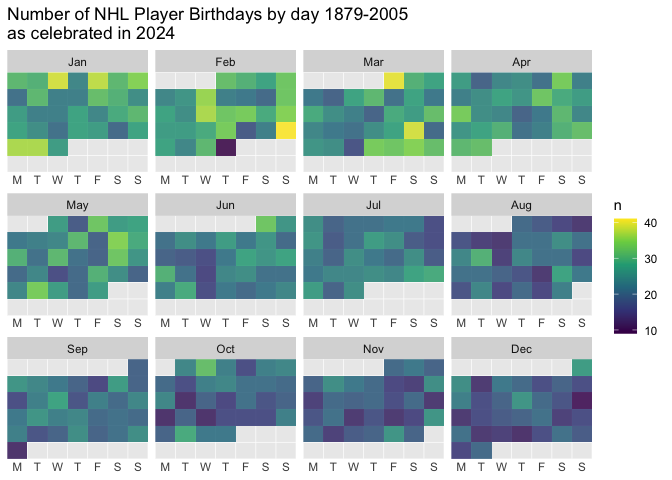

``` r

last_plot() +
  aes(label = n) + 
  geom_calendar_text(size = 3) +
  aes_autocontrast_color_on_fill + 
  guides(fill = "none")
```

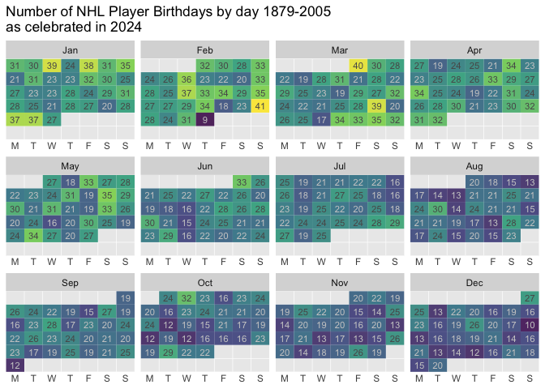

``` r
## basic example code
df_month(month = "2022-07") |> 
  head()

return_dates_interval(start_date = "2022-07-01", 
                      end_date = "2022-08-31") |> 
  ggcalendar() +
  aes(date = date) +
  geom_calendar_text(size = 8) + 
  geom_calendar_point(data = . %>% filter(date == "2022-07-04"),
                      size = 8, 
                      alpha = .5) +
  geom_calendar_point(data = . %>% filter(date < Sys.Date()),
                      size = 10, shape = "x")
```

------------------------------------------------------------------------

``` r
knitr::knit_exit()
```
